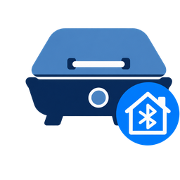

<p align="center">
  
</p>

<h1 align="center">Ninja Woodfire — Home Assistant</h1>

<p align="center">
  <a href="https://github.com/hacs/integration"></a>
</p>

Control and monitor the **Ninja Woodfire Connect Pro XL** (`OG900-EU`) grill in
Home Assistant — **fully local over Bluetooth**, or over the Ninja cloud.

> Hobby project, published as-is — no support, no warranty. Primarily a
> Claude-assisted project.

## Two ways to connect

Chosen in the setup wizard:

- **Cloud** — sign in with your Ninja Kitchen account (Ayla/AWS). The simplest
  start, no extra steps, and you can keep using the Ninja app alongside Home
  Assistant. *(recommended to start)*
- **Local (Bluetooth)** — no account, no cloud. Full cook control, live
  temperatures, meat probe and lid over Bluetooth (ESPHome proxies work). Needs a
  one-time key bundle you extract yourself from your own copy of the app — see
  **[Local setup — extract your keys](#local-setup--extract-your-keys)**.

Matching Lovelace card: [ninja-woodfire-card](https://github.com/coxtor/ninja-woodfire-card).

## Features

- **Cook control** — start, stop, skip-preheat, wake. Mode-aware target
  temperature, duration, smoke, per-probe targets. Live changes keep heat
  level, probe targets and elapsed time.
- **Sensors** — grill / air / smoke / meat-probe temperatures, cook & preheat
  progress, end-time, mode, setpoint, lid, per-probe status & target.
- **Diagnostics** — connection, backend, last report, Wi-Fi signal, poll health.
- **Events** for automations: `cook_started`, `preheat_complete`,
  `cook_halftime`, `cook_done`, `probe_halfway`, `probe_target_reached`,
  `prompt` (all prefixed `ninja_woodfire_`).

## Local control (no cloud)

Local communication with the grill over Bluetooth LE — no account needed. Cook
controls, live chamber and meat-probe temperatures, the lid state, the cook
phase (ignition / preheat / cooking) and the add-food / flip / done / get-food
prompts all work locally; the *Wake* button nudges a grill in standby back
online. Works through ESPHome Bluetooth proxies.

The phase and prompt are read from the grill's advertisement beacon. A few
states aren't mapped there yet — **contributions welcome**: the *resting* phase,
the *close-lid* prompt and the *end* screen. "Powered off" isn't broadcast at
all (the grill just stops advertising), so it simply shows as offline.

## Local setup — extract your keys

**This project ships no key material.** Talking to the grill locally needs a few
AES keys that live inside the vendor app. You extract them **once, yourself, from
your own copy of the app**, and paste the result into the integration. Nothing
secret is distributed here; the tool only reads the keys out of a copy you
already have, so that your own grill interoperates with Home Assistant.

**1. Get the Ninja app.** From your own device, or downloaded from another
source — an `.apkm`, `.apk` or an extracted `libgrillcore.so` all work. Use a
copy you're entitled to use.

**2. Run the extractor.** It needs Python 3 with a few packages; a throwaway
virtualenv keeps them off your system:

```bash
python3 -m venv /tmp/ninja && . /tmp/ninja/bin/activate
pip install unicorn capstone cryptography bleak
python3 scripts/extract_ninja_keys.py --app your-ninja-app.apkm
```

Power the grill on and keep it in range — if it's the only Woodfire nearby the
tool finds it automatically and prints a single key-bundle string. It pulls the
library out of the package, finds the key routine inside it, and runs it on
*your* copy; no keys are baked into the tool.

> The derived keys are specific to the grill's address. If auto-detect finds a
> single grill, double-check the printed address is **your own** before using
> the bundle; with several grills in range, pass `--mac` for yours.

**3. Paste it into Home Assistant.** *Add Integration → Ninja Woodfire → Local*
(the grill also shows up under Bluetooth auto-discovery), pick your grill and
paste the bundle. The keys stay on your machine. Cloud setup needs none of this.

**App versions.** The keys are the same across app versions; only their location
in the library moves, and the extractor finds that itself — so it isn't tied to
one build. Verified against:

| App version | `libgrillcore_android.so` SHA-256 |
|---|---|
| 1.17.1-2361 | `acb9dfab73c7a50f7c537e8e06f0d009567319d81aa58434e61df3be4c982f83` |
| 1.28.0-3274 | `02bd4536ab1e46312d5b5899cb08581c3fd6e3b61ccafa2d1cb75da1d44f62f1` |

Versions between (and newer ones) should work too; if auto-detection ever fails,
pass `--kdf 0x…`, and please open an issue so the version can be added here.

### Extractor flags

Normally you only need `--app` — the rest are for edge cases.

| Flag | Meaning |
|---|---|
| `--app PATH` | **(required)** the `.apkm` / `.apk` you got, or an extracted `libgrillcore.so`. |
| `--mac AA:BB:…` | your grill's Bluetooth address; skips the scan. **Required if more than one grill is in range** (the tool refuses to guess). |
| `--kdf 0x…` | override the key-routine address — only needed if auto-detection ever fails on a new build. |

## Install & set up

**Install (HACS):** HACS → Integrations → ⋮ → *Custom repositories* → add this
repo as *Integration* → install → restart. *(Or copy
`custom_components/ninja_woodfire/` manually and restart.)*

**Set up:** *Settings → Devices & services → Add Integration → Ninja Woodfire*,
then pick **Cloud** (sign in, pick your grill) or **Local** (paste the key bundle
from *Local setup — extract your keys* above).

## Blueprints (one-click import)

Ready-made Home Assistant automations — click to import, then pick your notify
service:

- **Cook prompts** (add food / flip / done / get food)
  [](https://my.home-assistant.io/redirect/blueprint_import/?blueprint_url=https%3A%2F%2Fgithub.com%2Fcoxtor%2Fninja-woodfire-integration%2Fblob%2Fmain%2Fblueprints%2Fautomation%2Fninja_woodfire%2Fcook_prompts.yaml)
- **Meat probe reached target** (optionally also at halfway)
  [](https://my.home-assistant.io/redirect/blueprint_import/?blueprint_url=https%3A%2F%2Fgithub.com%2Fcoxtor%2Fninja-woodfire-integration%2Fblob%2Fmain%2Fblueprints%2Fautomation%2Fninja_woodfire%2Fprobe_target.yaml)

## Node-RED notifications

A ready-to-import tab turns the integration's events into phone notifications —
generic, no private config. English (`woodfire_flow.json`) and German
(`woodfire_flow_de.json`): [`examples/node-red/`](examples/node-red/).

## Automations

```yaml
automation:
  - alias: "Steaks ready"
    trigger:
      - platform: event
        event_type: ninja_woodfire_probe_target_reached
        event_data: { probe_index: 0 }
    action:
      - service: notify.mobile_app
        data:
          message: "Probe 1 reached {{ trigger.event.data.target }}°C."
```

## Cloud notes

<details>
<summary>AWS migration, regions, credentials</summary>

SharkNinja is moving grills from Ayla to its own AWS backend. Migrated grills
are detected and used automatically (the *Backend* sensor shows which is live);
Ayla is still used for setup and renaming. AWS queues commands for a
disconnected grill, so a cook is only started on a connected grill and an
unacknowledged start is withdrawn after 20 s.

EU and NA defaults are bundled (only EU is exercised by the author). The bundled
cloud identifiers come from the official app; if they ever rotate and login
fails, extract a fresh set from your phone with
`python3 scripts/extract_credentials.py --region EU` (needs the Ninja app, USB
debugging and `adb`) and paste them into the *advanced* config fields.

</details>

## Status & disclaimer

Personal hobby project, **as-is — no support, no warranty**; the cloud path
depends on a third party that may change or break it at any time.

**Safety:** this integration starts, stops and changes **cooking on a device
with a heating element**. Treat it as a convenience, not a safety control —
never leave the grill running unattended, keep it clear of flammables, and don't
rely on automations for anything safety-critical. Please operate the grill
safely — within the limits of applicable law, the software is provided as-is
without warranty (see LICENSE), and that cannot override your own duty of care.

**Independent interoperability project.** This program is written to make your
*own* grill work with Home Assistant; it bundles no vendor application code,
libraries or keys. Any key extraction is done by you, locally, against your own
copy of the app, only to the extent needed for that interoperability. You are
responsible for complying with the app's terms and your local law.

Unofficial and independent — **not affiliated with or endorsed by SharkNinja
Operating LLC**. "Ninja", "Woodfire" and related names are trademarks of their
owners, used here only to identify the device this integrates with. Use at your
own risk. MIT — see [LICENSE](LICENSE).
